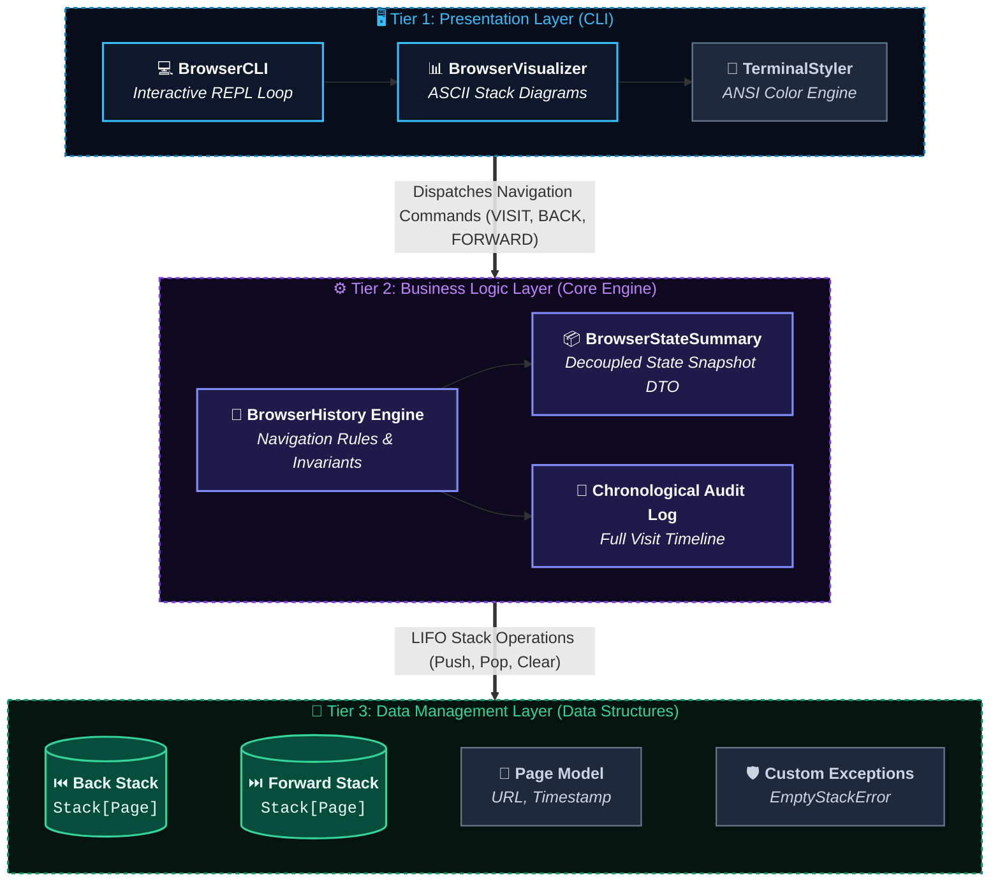

# 🌐 CLI Browser History Simulator

<div align="center">


-brightgreen.svg?style=for-the-badge)


<p align="center">
  A high-fidelity terminal browser history engine built from first principles using an encapsulated Stack Abstract Data Type (ADT) and 3-Tier Layered Modular Architecture.
</p>

</div>

---

## 📋 Implementation Plan: CLI Browser History Simulator

- **Project Title:** CLI Browser History Simulator
- **Course / Scope:** Data Structures Mini Project
- **Architecture Pattern:** 3-Tier Layered Modular Architecture
- **Core Data Structure:** Stack Abstract Data Type (ADT)

---

## 🎯 Executive Summary & Objectives

The **CLI Browser History Simulator** models real-world web browser navigation (Google Chrome, Firefox, Safari) using the **Stack Abstract Data Type (ADT)**.



### Key Technical Goals:
- **LIFO Paradigm**: Coordinate two stacks (`back_stack` and `forward_stack`) to provide $\mathcal{O}(1)$ navigation.
- **Layered Modular Architecture**: Complete decoupling of presentation, domain rules, and data structures.
- **Robustness & Clean Code**: Zero external dependencies, typed exceptions, 100% automated test coverage.

---

## 🏛 System Architecture: 3-Tier Layered Design

```
+----------------------------------------------------------------------+
|                       PRESENTATION LAYER (CLI)                       |
|   - Interactive REPL Loop (`BrowserCLI.run()`)                       |
|   - Command Parser & Input Sanitization                              |
|   - ASCII Dual-Stack Visualizer (`BrowserVisualizer`)                |
+----------------------------------------------------------------------+
                                   │  (Invokes domain methods)
                                   ▼
+----------------------------------------------------------------------+
|                       BUSINESS LOGIC LAYER                           |
|   - Navigation Rules (`visit`, `back`, `forward`)                    |
|   - Invariant Enforcement (Forward stack invalidation on new visit)  |
|   - Navigation State Snapshots (`BrowserStateSummary`)               |
|   - Chronological Audit Trail (`_audit_log`)                         |
+----------------------------------------------------------------------+
                                   │  (Invokes stack operations)
                                   ▼
+----------------------------------------------------------------------+
|                       DATA MANAGEMENT LAYER                          |
|   - Custom `Stack[T]` Abstract Data Type (LIFO)                      |
|   - Domain Models (`Page`, `BrowserStateSummary`)                    |
|   - Custom Exceptions (`EmptyStackError`, `NavigationError`)         |
+----------------------------------------------------------------------+
```

### 1. Presentation Layer (`presentation/`)
- `cli.py`: Interactive Read-Eval-Print Loop (REPL), parses commands, dispatches actions, and provides user feedback.
- `visualizer.py`: Renders real-time ASCII dual-stack diagrams and ANSI color formatting with fallback.

### 2. Business Logic Layer (`core/`)
- `browser.py`: Implements navigation mechanics, invariant enforcement, and history tracking.
- `models.py`: Immutable `Page` model and decoupled `BrowserStateSummary` data transfer object.

### 3. Data Management Layer (`data_structures/`)
- `stack.py`: Encapsulated, generic `Stack[T]` ADT adhering to strict LIFO semantics.
- `exceptions.py`: Typed hierarchy (`StackError`, `EmptyStackError`, `StackOverflowError`, `NavigationError`).

---

## 📦 Data Structure Specification (Stack ADT)

All stack operations adhere to strict theoretical time complexities:

| Method | Signature | Description | Time Complexity |
| :--- | :--- | :--- | :---: |
| `push` | `push(item: T) -> None` | Inserts an item onto the top of the stack | $\mathcal{O}(1)$ |
| `pop` | `pop() -> T` | Removes and returns the top element | $\mathcal{O}(1)$ |
| `peek` | `peek() -> T` | Returns top element without removing it | $\mathcal{O}(1)$ |
| `is_empty` | `is_empty() -> bool` | Checks if stack contains zero items | $\mathcal{O}(1)$ |
| `size` | `size() -> int` | Returns current element count | $\mathcal{O}(1)$ |
| `clear` | `clear() -> None` | Removes all elements from stack | $\mathcal{O}(1)$ |

---

## 🔄 State Transition Matrix

The table below documents how navigation commands mutate the system's state variables:

| # | Initial State `(back_stack, current_page, forward_stack)` | Command | Resulting `back_stack` | Resulting `current_page` | Resulting `forward_stack` | Explanation |
| :-: | :--- | :--- | :---: | :---: | :---: | :--- |
| **1** | `([], None, [])` | `VISIT A` | `[]` | `"A"` | `[]` | First page opened; nothing pushed to back stack. |
| **2** | `(["A"], "B", [])` | `VISIT C` | `["A", "B"]` | `"C"` | `[]` | Current page `"B"` pushed to back stack; forward stack cleared. |
| **3** | `(["A"], "B", ["C"])` | `BACK` | `[]` | `"A"` | `["C", "B"]` | `"B"` pushed to forward stack; `"A"` popped to active page. |
| **4** | `(["A"], "B", ["C"])` | `FORWARD` | `["A", "B"]` | `"C"` | `[]` | `"B"` pushed to back stack; `"C"` popped to active page. |
| **5** | `(["A"], "B", ["C"])` | `VISIT D` | `["A", "B"]` | `"D"` | `[]` | Forward history `["C"]` is invalidated and purged. |

---

## ⚡ Complexity Analysis

- **Time Complexity**:
  - `visit(url)`: $\mathcal{O}(1)$ — Single push to back stack, constant-time reset of forward stack.
  - `back()`: $\mathcal{O}(1)$ — Single push to forward stack, single pop from back stack.
  - `forward()`: $\mathcal{O}(1)$ — Single push to back stack, single pop from forward stack.
  - `peek_back()` / `peek_forward()`: $\mathcal{O}(1)$ — Constant-time top inspection.
- **Space Complexity**:
  - Overall memory consumption is $\mathcal{O}(N)$ where $N$ is the number of visited pages retained in stacks.

---

## 🚀 Quick Start & Interactive Demo

### Prerequisites
- Python 3.8 or higher (No third-party packages required — uses standard library).

### Launching the Simulator
```bash
python3 main.py
```

### Live Interactive Session Preview
```text
================================================================
     🌐 CLI BROWSER HISTORY SIMULATOR (DS MINI PROJECT)
   Layered Architecture | Dual-Stack LIFO Engine | Audit Trail
================================================================
Type HELP to view available commands, or VISIT <url> to begin.

[Browser] » VISIT google.com
✔ Navigated to: https://google.com

[Browser] » VISIT github.com
✔ Navigated to: https://github.com

[Browser] » VISIT stackoverflow.com
✔ Navigated to: https://stackoverflow.com

[Browser] » BACK
◀ Back to: https://github.com

[Browser] » STATUS

════════════════════════════════════════════════════════════
                 📊 BROWSER STACK INSPECTOR
════════════════════════════════════════════════════════════
  [ FORWARD STACK ] (LIFO - Top to Bottom)
    ▲ [Top]    https://stackoverflow.com (11:02:15)
  ────────────────────────────────────────────────────────────
  >>> 🌐 ACTIVE PAGE: https://github.com <<<
      Visited at: 11:02:10
  ────────────────────────────────────────────────────────────
  [ BACK STACK ]    (LIFO - Top to Bottom)
    ▼ [Top]    https://google.com (11:02:05)
════════════════════════════════════════════════════════════
  Back: 1 item(s) | Forward: 1 item(s) | Total Visits: 3
════════════════════════════════════════════════════════════

[Browser] » LOG

📜 Chronological Browsing History:
Index  Time      URL
--------------------------------------------------
[01]   11:02:05  https://google.com
[02]   11:02:10  https://github.com
[03]   11:02:15  https://stackoverflow.com
--------------------------------------------------
```

---

## ⌨️ Command Reference

| Command | Syntax | Description |
| :--- | :--- | :--- |
| `VISIT` | `VISIT <url>` | Navigates to a new URL and invalidates forward history |
| `BACK` | `BACK` | Steps back to the previous page (LIFO back pop) |
| `FORWARD` | `FORWARD` | Steps forward to the next page (LIFO forward pop) |
| `STATUS` | `STATUS` | Displays real-time ASCII dual-stack diagram |
| `PEEK` | `PEEK` | Inspects adjacent pages without moving |
| `LOG` | `LOG` | Displays complete chronological audit trail |
| `CLEAR` | `CLEAR` | Resets back and forward stacks |
| `HELP` | `HELP` | Displays available commands |
| `QUIT` | `QUIT` / `EXIT` | Safely terminates the simulator |

---

## 🧪 Automated Testing

Run the full automated test suite containing 17 unit tests:

```bash
python3 -m unittest discover -s tests -v
```

### Test Coverage Highlights:
- ✅ **LIFO Ordering**: Verifies elements emerge in reverse order of insertion.
- ✅ **Boundary Safety**: Prevents `IndexError` on empty pops/peeks, verifying typed `EmptyStackError`.
- ✅ **Invariant Compliance**: Asserts forward stack is cleared whenever a new URL is visited.
- ✅ **State Matrix**: 100% passes all transitions in the State Transition Matrix.

---

## 📁 Repository Structure

```text
ds_mini-project/
├── data_structures/
│   ├── __init__.py
│   ├── stack.py             # Encapsulated Generic Stack ADT
│   └── exceptions.py        # Custom Exception Hierarchy
├── core/
│   ├── __init__.py
│   ├── models.py            # Page Model & State Summary DTO
│   └── browser.py           # BrowserHistory Business Logic
├── presentation/
│   ├── __init__.py
│   ├── visualizer.py        # ASCII Visualizer & ANSI Styler
│   └── cli.py               # Interactive REPL Controller
├── tests/
│   ├── __init__.py
│   ├── test_stack.py        # Stack ADT Unit Tests
│   └── test_browser.py      # Browser Navigation Unit Tests
├── main.py                  # Executable Application Entry Point
├── IMPLEMENTATION_PLAN.md   # Detailed Implementation Specifications
├── README.md                # Project Documentation & Architecture
└── .gitignore               # Python and OS Ignore Rules
```

---

## 📄 License
This project is licensed under the MIT License — open for academic learning and portfolio reference.
